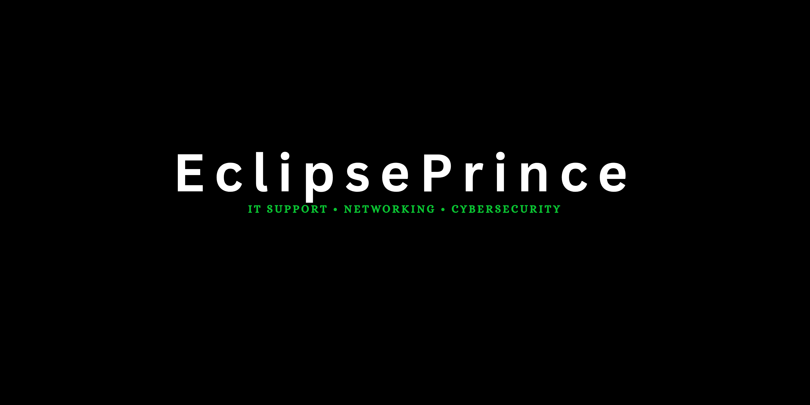

👋 Hi, I'm EclipsePrince

IT Support Technician | Aspiring Cybersecurity Professional

I'm an IT Support Technician with a growing passion for technology, IT infrastructure, networking, and cybersecurity.

I enjoy troubleshooting technical problems, understanding how systems work, and exploring ways to strengthen technology and security.

🎯 Areas of Interest

- 🖥️ IT Support & Systems Administration
- 🌐 Computer Networking & Infrastructure
- 🐧 Linux & Operating Systems
- 🔐 Cybersecurity & Ethical Hacking
- 💻 Virtualisation & Virtual Lab Environments

🛠️ Technologies & Tools

"Windows" (https://img.shields.io/badge/Windows-0078D6?style=for-the-badge&logo=windows&logoColor=white)
"Linux" (https://img.shields.io/badge/Linux-FCC624?style=for-the-badge&logo=linux&logoColor=black)
"VirtualBox" (https://img.shields.io/badge/VirtualBox-183A61?style=for-the-badge&logo=virtualbox&logoColor=white)
"Networking" (https://img.shields.io/badge/Networking-2E8B57?style=for-the-badge&logo=cisco&logoColor=white)
"Cybersecurity" (https://img.shields.io/badge/Cybersecurity-111111?style=for-the-badge&logo=hackthebox&logoColor=9FEF00)

📊 GitHub Statistics

"EclipsePrince GitHub Stats" (https://github-readme-stats.vercel.app/api?username=EclipsePrince&show_icons=true&theme=dark&hide_border=true&bg_color=0D1117&title_color=00FF99&icon_color=00FF99&text_color=FFFFFF)

"Top Languages" (https://github-readme-stats.vercel.app/api/top-langs/?username=EclipsePrince&layout=compact&theme=dark&hide_border=true&bg_color=0D1117&title_color=00FF99&text_color=FFFFFF)

"GitHub Streak" (https://streak-stats.demolab.com?user=EclipsePrince&theme=dark&hide_border=true&background=0D1117&ring=00FF99&fire=00FF99&currStreakLabel=00FF99)

IT Support & Systems

- Windows Operating Systems
- Hardware & Software Troubleshooting
- Computer Configuration & Maintenance
- Printer Installation & Troubleshooting
- Technical Support

Networking

- TCP/IP Fundamentals
- IP Address Configuration
- DNS & DHCP Fundamentals
- Network Connectivity Troubleshooting
- Basic Network Diagnostics

Operating Systems & Virtualisation

- Windows
- Linux
- Oracle VirtualBox
- Virtual Machine Configuration
- Virtual Lab Environments

Cybersecurity

- Cybersecurity Fundamentals
- Information Security Concepts
- Ethical Hacking (Learning)
- Practical Security Labs

📚 Currently Learning

- CompTIA A+ — Preparing
- Cybersecurity Fundamentals
- Linux Administration
- Network Security
- Practical Cybersecurity

🚀 Career Goals

My long-term goal is to grow into a Cybersecurity professional by strengthening my technical foundation, gaining hands-on experience, and continuously exploring new technologies.

🤝 Connect With Me

- GitHub: "@EclipsePrince" (https://github.com/EclipsePrince)
- LinkedIn: (https://linkedin/Triston_Petersen)

---

---

⚡ My Philosophy

«Technology is constantly evolving. So am I.»

Learning. Troubleshooting. Securing. Evolving.
